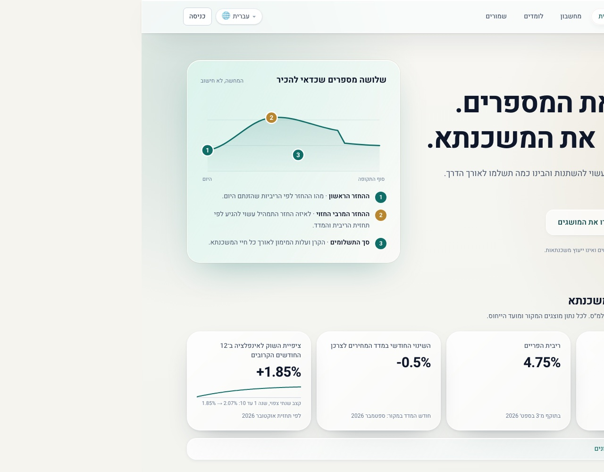
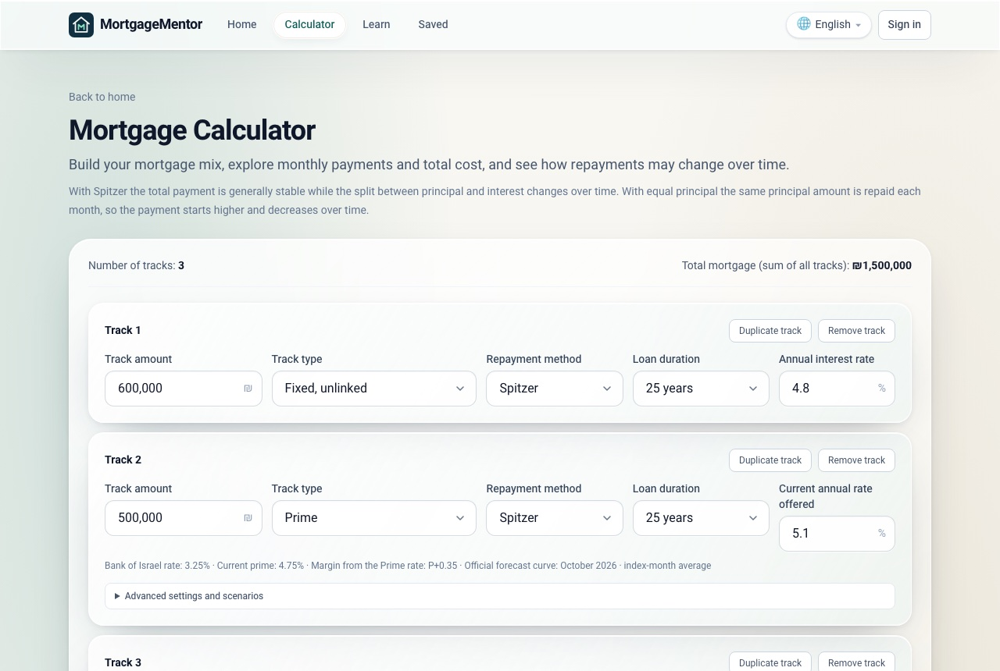
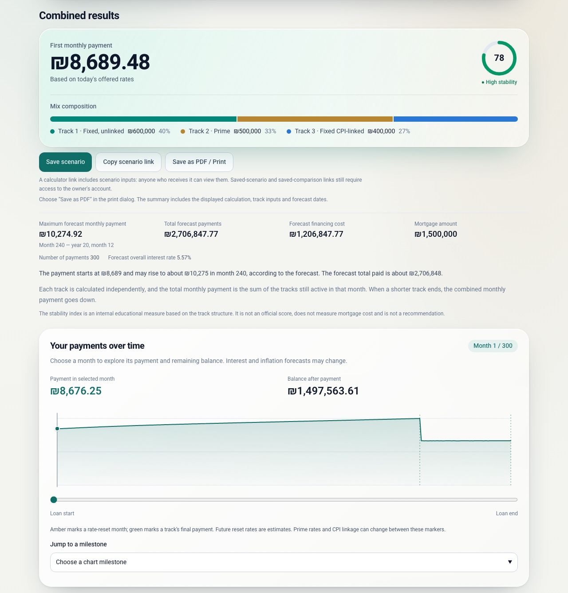
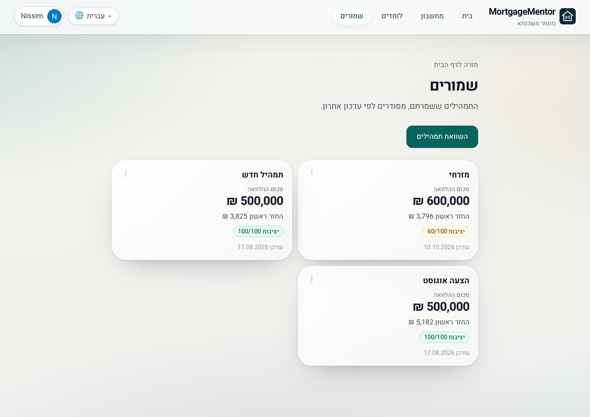
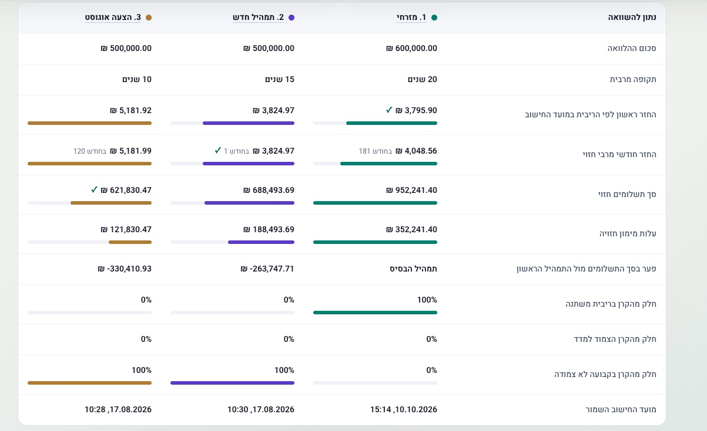
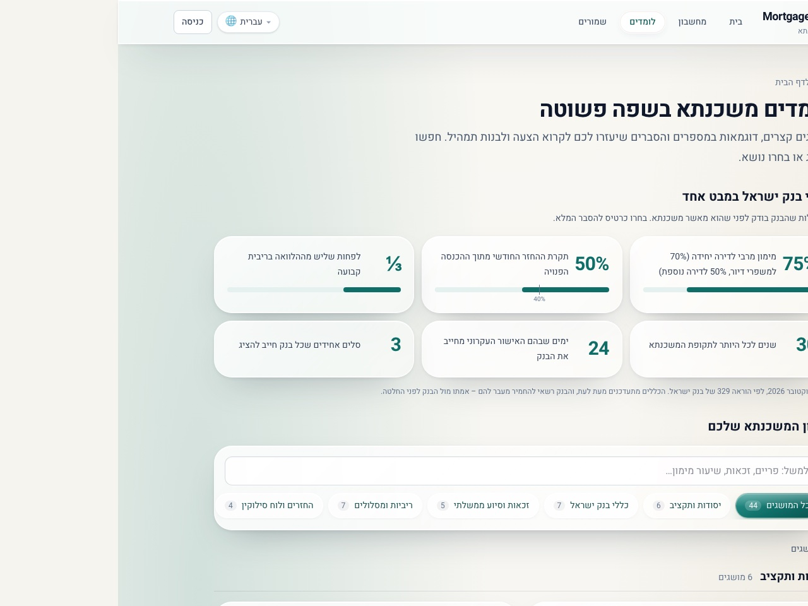
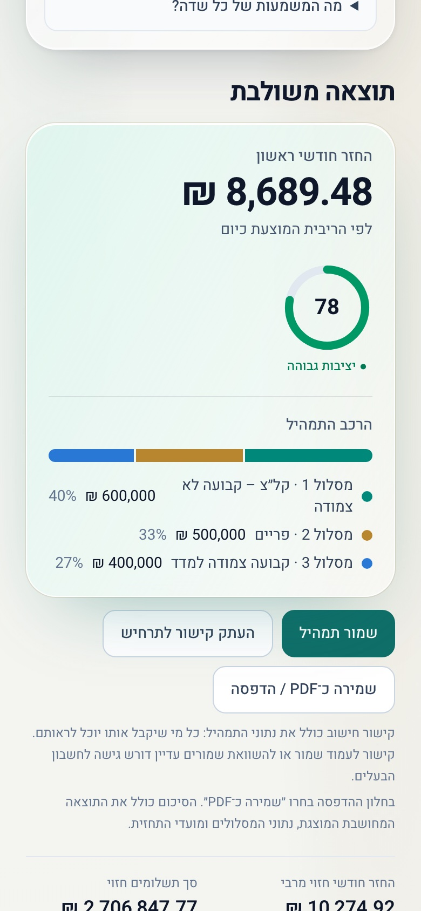
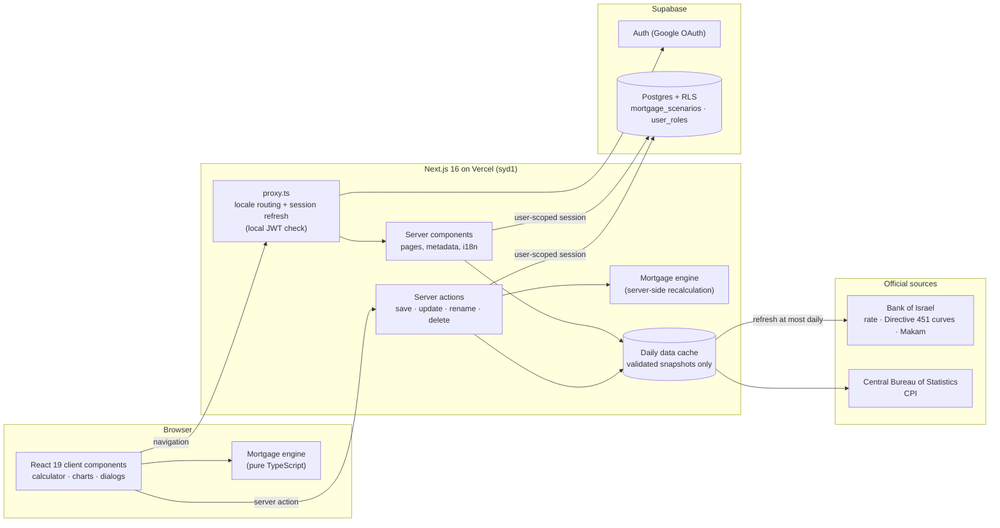

<div align="center">


# MortgageMentor · מנטור משכנתא

**Understand the numbers. Plan the mortgage.**
<br />
A bilingual (Hebrew/English) Israeli mortgage-mix calculator built on official Bank of Israel forecasts.

<p dir="rtl"><b>מבינים את המספרים. מתכננים את המשכנתא.</b><br />מחשבון תמהיל משכנתא בעברית ובאנגלית, המבוסס על תחזיות רשמיות של בנק ישראל.</p>

[**Live app →**](https://mortgage-mentor-fawn.vercel.app/he)


[](LICENSE)



</div>

---

## Contents

- [Why MortgageMentor](#why-mortgagementor)
- [Features](#features)
- [Screenshots](#screenshots)
- [How the calculation works](#how-the-calculation-works)
- [Official data sources](#official-data-sources)
- [Architecture](#architecture)
- [Getting started](#getting-started)
- [Testing and quality](#testing-and-quality)
- [Security and privacy](#security-and-privacy)
- [Project structure](#project-structure)
- [Accuracy and limitations](#accuracy-and-limitations)
- [Roadmap](#roadmap)
- [Further documentation](#further-documentation)
- [Contact](#contact)
- [License](#license)

## Why MortgageMentor

An Israeli mortgage is usually a **mix** of several tracks: fixed and variable, CPI-linked and unlinked, each with its own term and repayment method. Bank offers show a first monthly payment, but the real question is how that payment may **change** over 20 to 30 years as the prime rate, bond yields and inflation move.

MortgageMentor answers that question with the same inputs banks are required to use: the Bank of Israel's **Directive 451** forecast curves, the current policy rate and the official CPI. You can build a mix, see every month of the schedule, compare saved scenarios and learn the vocabulary, with no sign-up needed to calculate.

## Features

### Calculator
- **Six track types:** fixed unlinked (קל״צ), prime, variable unlinked anchored to government bonds (2 to 10-year resets), variable unlinked anchored to the annual Makam, fixed CPI-linked, and variable CPI-linked (5-year reset).
- **Spitzer and equal-principal** repayment, nominal or effective annual rate input.
- **Three forecast modes per track:** the official BOI forecast (default), a constant current rate, or a stress test that adds a parallel shift to rates and/or inflation.
- **Combined results:** first payment, forecast maximum payment and when it happens, total paid, financing cost, overall forecast rate and a mix-composition bar.
- **Stability index:** an educational 0–100 score of how predictable the mix is, shown for the whole mix and for each track.
- **Payments-over-time chart** with a keyboard-accessible month slider and milestone markers (rate resets, track end dates).
- **Full amortization schedule**, combined or per track. Each month is labelled as contractual, rate-forecast, index-forecast or both.
- **CSV export** (Excel-friendly Hebrew, formula-injection safe) and a **printable PDF summary**.
- **Shareable links:** the whole scenario lives in the URL, and forecast curves are pinned so a shared link reproduces the exact calculation.
- **Draft recovery:** unsaved inputs survive a reload in the same tab.

### Saved scenarios and comparison
- **Google sign-in** (Supabase Auth) to save, rename, duplicate, edit and delete scenarios.
- **Optimistic concurrency** on edit: saving over a scenario changed in another tab is detected, never silently overwritten.
- **Side-by-side comparison** of 2–3 saved scenarios with payment charts reconstructed from each scenario's pinned historical market data.

### Learning centre
- **44-term illustrated glossary** in plain language, grouped by topic, with search, category filters and worked examples.
- **Bank of Israel rules at a glance:** LTV limits, payment-to-income ratio, minimum fixed-rate share, maximum term, and more.

### Platform
- **Hebrew-first, fully RTL**, with a complete English version and a language switch that keeps your inputs.
- **Mobile-first** layout with a bottom tab bar, safe-area support and Home Screen icons.
- **Accessibility:** keyboard navigation, focus management in dialogs, reduced-motion and reduced-transparency support, and an accessibility statement.
- **Role-based admin area** (owner / administrator / user) with aggregate usage metadata only, never other users' financial data.
- Privacy policy, terms of use and accessibility statement in both languages.

## Screenshots

<table>
  <tr>
    <td width="50%"></td>
    <td width="50%"></td>
  </tr>
  <tr>
    <td align="center"><sub><b>Build a mix:</b> each track has its own type, term, rate and forecast mode</sub></td>
    <td align="center"><sub><b>See the outcome:</b> first and peak payment, total cost, stability, month-by-month chart</sub></td>
  </tr>
</table>

<table>
  <tr>
    <td width="46%"></td>
    <td width="54%"></td>
  </tr>
  <tr>
    <td align="center"><sub><b>Saved scenarios:</b> every mix you save, with its key figures</sub></td>
    <td align="center"><sub><b>Compare:</b> two or three saved mixes side by side, best value per row marked</sub></td>
  </tr>
</table>

<table>
  <tr>
    <td width="56%"></td>
    <td width="22%"></td>
    <td width="22%"></td>
  </tr>
  <tr>
    <td align="center"><sub><b>Learning centre</b> (Hebrew)</sub></td>
    <td align="center" colspan="2"><sub><b>Mobile</b>, right-to-left</sub></td>
  </tr>
</table>

## How the calculation works

The engine in [`lib/mortgage/`](lib/mortgage/) is pure TypeScript with no framework dependencies, so the same code runs in the browser, on the server and in tests.

| Track | How future payments are projected |
| --- | --- |
| Fixed unlinked | Contractual schedule. No forecast needed. |
| Prime | The customer's margin over prime is kept. Future prime follows the annualised one-month forwards of the BOI nominal zero curve, plus 1.5 percentage points. |
| Variable, government-bond anchor | The margin over the BOI nominal zero yield at the reset maturity is kept. Each reset period then uses the curve's forward rate for that period plus the margin. |
| Variable, Makam anchor | 12-month resets projected with the same nominal-curve forwards as the bond track. The observed 12-month Makam yield is shown as reference only, matching bank calculators. |
| Fixed CPI-linked | Fixed real rate. Principal and payments are indexed to the BOI expected-CPI path (361 monthly points). |
| Variable CPI-linked | Five-year resets along the BOI real curve, plus CPI indexation. |

- Spitzer payments use numerically stable annuity formulas (`log1p` / `expm1`), so near-zero rates stay accurate.
- The combined schedule is the month-by-month sum of every track still active, so the payment drops when a shorter track ends.
- The overall forecast interest rate is solved as an internal rate of return over the combined cash flows.
- Every saved result is stamped with a `calculator_version`, so a later methodology change never rewrites a historical snapshot.

## Official data sources

All market data is fetched **server-side** from official public sources. It is validated and cached for 24 hours, and if a source fails the app falls back to clearly dated bundled values instead of breaking.

| Data | Source |
| --- | --- |
| Policy rate (and prime = rate + 1.5%) | Bank of Israel SDMX statistics API |
| Latest CPI and monthly change | Central Bureau of Statistics index API (series 120010) |
| Directive 451 forecast curves: nominal and real zero yields (1–360 months) and expected CPI index | Bank of Israel workbooks, joined with the official publication schedule. A curve becomes active on the next Israeli banking day. |
| 12-month Makam anchor | Bank of Israel SDMX SECDWH series |

Each card and track shows its source date, and stale or fallback data gets a visible warning.

## Architecture



Key design decisions:

- **The server never trusts client results.** When a scenario is saved, the server re-fetches market data, recalculates from the raw inputs and stores the result snapshot itself.
- **Inputs are the source of truth.** `input_payload` reproduces a scenario exactly. `result_snapshot` is a small historical cache for fast list rendering. `market_references` records which curve and Makam snapshot produced it.
- **Pinned history.** Shared links and saved scenarios reference curve IDs (for example `2026-09-calendar`). The server resolves them against the full workbook history, and an unknown ID is reported, never silently replaced. Most requests need only the operative curve, so they read a small cache entry with the newest curves. The ~1 MB full history is read only for an older pinned curve.
- **Compute next to the data.** Functions run in Sydney (`syd1`, set in [`vercel.json`](vercel.json)), the same region as the Supabase database, so each auth or database call is a local hop. The proxy verifies the session JWT locally (`getClaims`) instead of calling the auth server on every request. Pages and server actions still call `getUser()` before touching data.
- **Streaming home page.** The hero and navigation render immediately. Market cards stream in behind a Suspense boundary, so a cold data cache never blocks the page.
- **Light client bundle.** Calculator state updates the URL through the native History API, with no server round trip per calculation. The Supabase SDK and the print report load on demand.
- **Work proportional to what is shown.** Saved scenarios are paginated (24 per page). The comparison page reconstructs monthly payment series only for the mixes on screen, and fetches others when they are selected.

## Getting started

### Prerequisites

- Node.js 20.9 or newer (developed on Node 24)
- A [Supabase](https://supabase.com) project, needed only for sign-in and saved scenarios. The calculator and learning centre work without an account.

### Install and run

```bash
git clone https://github.com/nissimcoh/mortgage-mentor.git
cd mortgage-mentor
npm ci
```

Create `.env.local` in the project root:

```bash
NEXT_PUBLIC_SUPABASE_URL=https://<your-project-ref>.supabase.co
NEXT_PUBLIC_SUPABASE_PUBLISHABLE_KEY=<your-publishable-key>
```

Both values are browser-safe by design. **Never** add a service-role or secret key: the app does not use one, and Row Level Security is the enforcement boundary.

Apply the database migrations:

```bash
npx supabase link --project-ref <your-project-ref>
npx supabase db push
```

To enable Google sign-in, configure the Google provider in the Supabase dashboard (Authentication → Providers) and add `http://localhost:3000/**` to the allowed redirect URLs (Authentication → URL Configuration).

```bash
npm run dev
```

Open [http://localhost:3000](http://localhost:3000). It redirects to the Hebrew site at `/he`. The English site is at `/en`.

### Scripts

| Command | What it does |
| --- | --- |
| `npm run dev` | Development server |
| `npm run build` | Production build, including type checking |
| `npm start` | Serve the production build |
| `npm test` | Run the full offline test suite once |
| `npm run test:watch` | Tests in watch mode |
| `npm run lint` | ESLint |
| `npm run smoke` | Start a production server and check 27 key routes (run `npm run build` first) |
| `npm run check:data` | Opt-in live check that every official source is reachable and fresh |

## Testing and quality

- **750+ unit, component and regression tests** with [Vitest](https://vitest.dev). They run offline: network sources are replaced by real in-memory workbooks and recorded responses.
- **Bank calibration:** every forecast product is compared month by month against Bank Leumi's public calculator. Government-bond tracks match exactly, and Makam and CPI-linked tracks are within ₪0.01 per month. See [`docs/CALIBRATION_TODO.md`](docs/CALIBRATION_TODO.md).
- **Database tests** for migrations, RLS policies and role management in [`supabase/`](supabase/).
- **Route smoke tests** against a real production build, including the iOS Home Screen icon.
- **Bounded local load diagnostic:** `node scripts/load-local.mjs` (see [`docs/SCALABILITY_REVIEW.md`](docs/SCALABILITY_REVIEW.md)).

## Security and privacy

- **Row Level Security** on every table. Users can read and change only their own scenarios. The single owner account can also read scenarios for administration. Admin capabilities are `SECURITY DEFINER` functions that check the caller's role on every call.
- **No elevated keys.** Every database request runs as the signed-in user, with that user's own session.
- **Minimal data.** No ID numbers, salaries, banks or addresses are stored, only what is needed to reproduce a scenario.
- **No leaky URLs.** Scenario inputs live in the URL, so `Referrer-Policy: no-referrer` keeps them from being forwarded to other sites.
- **Safe errors.** Database errors are logged without tokens or financial payloads, and users see only translated, generic messages.
- **CSV injection protection** on every exported text cell.

## Project structure

```text
app/
  [locale]/                 Hebrew and English routes (/he, /en)
    calculator/             Mortgage-mix calculator
    compare/                Saved-scenario comparison
    learn/                  Glossary and Bank of Israel rules
    saved/                  Saved scenarios and scenario detail
    admin/                  Role-based administration
    auth/callback/          OAuth code exchange
    dictionaries/           he.json (source of truth) and en.json
components/                 React components (client and server)
lib/
  mortgage/                 Pure calculation engine: amortization, forecasts, stability
  market-data/              Official source adapters, parsing, daily cache, fallbacks
  scenarios/                Save pipeline, payload validation, comparison
  supabase/                 Browser, server and proxy clients
  admin/ auth/ forms/ i18n/ legal/ ui/
supabase/
  migrations/               Schema, RLS policies and admin functions
proxy.ts                    Locale routing and session refresh
scripts/                    Smoke tests, live data check, load diagnostic, brand assets
docs/                       Reviews, calibration, launch and brand notes
```

## Accuracy and limitations

MortgageMentor is an **educational tool, not financial advice** and not a binding bank offer.

- It is a monthly simulation. It does not model bank fees, day-count conventions, actual payment dates or early-repayment penalties.
- Forecasts are the Bank of Israel's model forecasts, not predictions of what will happen. Use the stress mode to see a range.
- The eligibility track (משכנתא בזכאות), balloon and grace repayment are not modelled yet.
- The stability index is an internal comparison aid, not an official score or a recommendation.

## Roadmap

- [ ] Eligibility (Ministry of Housing) track
- [ ] Balloon and grace repayment methods
- [ ] Scheduled refresh of official market snapshots
- [ ] Calibration against additional banks

## Further documentation

| Document | Topic |
| --- | --- |
| [CALCULATOR_REVIEW.md](docs/CALCULATOR_REVIEW.md) | Calculator accuracy work and calibration differences |
| [CALIBRATION_TODO.md](docs/CALIBRATION_TODO.md) | Bank calibration cases and backlog |
| [PERFORMANCE_REVIEW.md](docs/PERFORMANCE_REVIEW.md) | First-load performance and infrastructure evidence |
| [SCALABILITY_REVIEW.md](docs/SCALABILITY_REVIEW.md) | Load diagnostics and scaling priorities |
| [ADMIN_ROLES.md](docs/ADMIN_ROLES.md) | Owner, administrator and user roles |
| [BRAND_ASSETS.md](docs/BRAND_ASSETS.md) | Logo, icons and palette |
| [LEGAL_READINESS.md](docs/LEGAL_READINESS.md) | Privacy, terms and accessibility |

## Contact

Built by **Nissim Cohen**.

[](https://www.linkedin.com/in/nissim-cohen7)
[](mailto:nissssssim@gmail.com)

Questions, bug reports and calibration cases from other banks are welcome, by email or as a GitHub issue.

## License

The source code is released under the [MIT License](LICENSE). The MortgageMentor name and logo are not covered by the license. Market data belongs to the Bank of Israel and the Central Bureau of Statistics and is subject to their terms.

---

<div align="center">
<sub>Built by Nissim Cohen · Market data © Bank of Israel and the Central Bureau of Statistics</sub>
</div>
